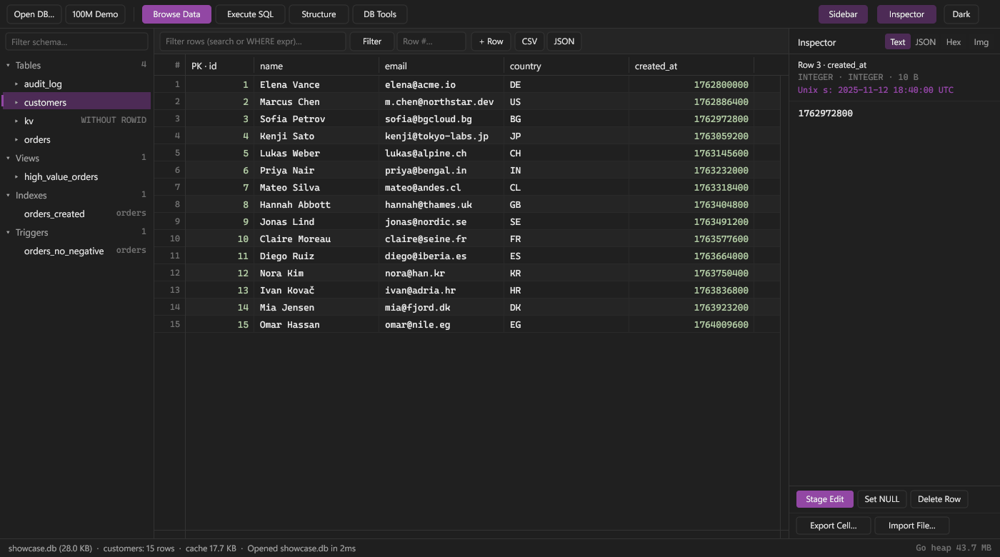
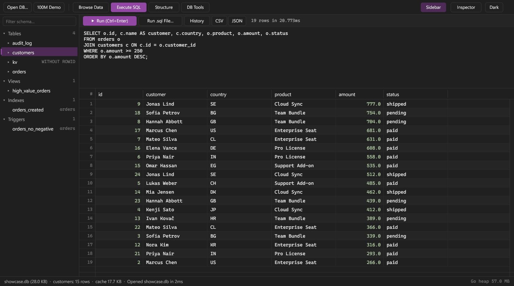
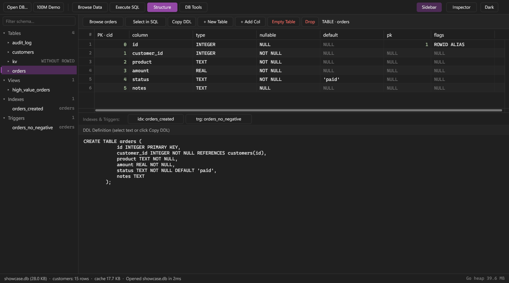

# 🗄️ SQLStrata

Native, pure-Go (`CGO_ENABLED=0`) SQLite GUI editor for Windows 11 built with [Gio](https://gioui.org) and [`ncruces/go-sqlite3`](https://github.com/ncruces/go-sqlite3).

Jump to: [Screenshots](#screenshots) · [Features](#features) · [Keyboard Shortcuts](#keyboard-shortcuts) · [Build & Run](#build--run) · [Project Layout](#project-layout)

## Screenshots



| Execute SQL & Results | Structure & DDL Designer |
| :---: | :---: |
|  |  |

## Features

- ⚡ **Memory-Bounded Table Grid** — Virtualized keyset pagination, resizable & auto-fit columns, smooth wheel/scrollbar navigation, plus a `100M`-row demo ([`table.go`](internal/data/table.go), [`grid.go`](internal/ui/widgets/grid.go)).
- 🛡️ **Safe Staged Editing** — Stage cell edits, new rows, and deletes with optimistic conflict checks, SQL preview, [`Ctrl+Z` / `Ctrl+Y`](#keyboard-shortcuts) undo/redo, and atomic `COMMIT` ([`changeset.go`](internal/edit/changeset.go)).
- 🔍 **Cell Inspector Pro** — Inspect Text, JSON, Hex, and PNG/JPEG/GIF Image previews, page huge BLOBs in `64 KB` windows, view Unix timestamp hints, and import/export raw cells ([`inspector.go`](internal/ui/widgets/inspector.go)).
- 💻 **SQL Runner & Spooling** — Schema-aware SQL editor ([`F5` / `Ctrl+Enter`](#keyboard-shortcuts)), query history, streamed `.sql` scripts, and disk-backed [`ResultSpool`](internal/data/spool.go) above `2,000` rows ([`sqlview.go`](cmd/sqlstrata/sqlview.go)).
- 🧱 **Schema & Table Designer** — Visual `+ New Table` (`WITHOUT ROWID`, `STRICT`), inline `+ Add Col` via native `ALTER TABLE` or 12-step rebuild (`PRAGMA foreign_key_check`), and two-click `Empty` / `Drop` ([`schema_plan.go`](internal/edit/schema_plan.go), [`structure.go`](cmd/sqlstrata/structure.go)).
- 📦 **Import, Export & DB Tools** — Auto-delimited CSV/TSV import with type inference, full `.sql` database dumps, CSV/JSON exports, `PRAGMA` health checks, and `VACUUM INTO` ([`import.go`](internal/iofmt/import.go), [`sqldump.go`](internal/iofmt/sqldump.go), [`tools.go`](cmd/sqlstrata/tools.go)).

## Keyboard Shortcuts

### App & Workflow

| Shortcut | Action | Source |
| :--- | :--- | :--- |
| `Ctrl+O` / `Ctrl+Shift+O` | 📂 Open database (Shift = Read-Only) | [`main.go`](cmd/sqlstrata/main.go#L917-L918) |
| `Ctrl+N` | 🆕 Create new SQLite database | [`main.go`](cmd/sqlstrata/main.go#L919-L920) |
| `Ctrl+P` / `Ctrl+Shift+P` | 🧭 Toggle Command Palette | [`main.go`](cmd/sqlstrata/main.go#L946-L951) |
| `Ctrl+B` / `Ctrl+I` | 📐 Toggle Schema Sidebar / Cell Inspector | [`main.go`](cmd/sqlstrata/main.go#L921-L924) |
| `Ctrl+S` | ✅ Review & commit staged changes | [`main.go`](cmd/sqlstrata/main.go#L925-L931) |
| `Ctrl+Z` / `Ctrl+Y` | ↩️ Undo / Redo staged grid edits | [`main.go`](cmd/sqlstrata/main.go#L932-L945) |
| `F5` / `Ctrl+Enter` | ▶️ Execute SQL in Query tab | [`main.go`](cmd/sqlstrata/main.go#L962-L965) |
| `Esc` | ❌ Close palette, designer, or inline edit | [`main.go`](cmd/sqlstrata/main.go#L952-L961) · [`grid.go`](internal/ui/widgets/grid.go#L401-L409) |

### Data Grid Navigation

| Shortcut | Action | Source |
| :--- | :--- | :--- |
| `Arrow Keys` / `PgUp` / `PgDn` | 🧭 Move cell selection & page rows | [`grid.go`](internal/ui/widgets/grid.go#L1031-L1043) |
| `Home` / `End` (`Ctrl+`) | ⏮️ First/last column (`Ctrl+`: first/last row) | [`grid.go`](internal/ui/widgets/grid.go#L1044-L1056) |
| `F2` / `Enter` | ✏️ Inline edit selected cell (`<= 256 B`) | [`grid.go`](internal/ui/widgets/grid.go#L1020-L1023) |
| `Ctrl+C` | 📋 Copy selected cell value to clipboard | [`grid.go`](internal/ui/widgets/grid.go#L1004-L1019) |

## Build & Run

Requires **Go 1.27+** on Windows (`CGO_ENABLED=0`) using [`build.ps1`](build.ps1):

```powershell
.\build.ps1                # Build sqlstrata.exe
.\build.ps1 -Test -Tools   # Run go vet + go test, build sqlstrata.exe & gendb.exe
.\build.ps1 -Gui -Run      # Build GUI subsystem binary (no console) & launch
.\sqlstrata.exe -ro db.db  # Optional: open a database directly in read-only mode
```

Generate a large synthetic test database with [`cmd/gendb`](cmd/gendb/main.go):

```powershell
.\gendb.exe -o testdata/big.db -rows 10000000
```

## Project Layout

- [`cmd/sqlstrata`](cmd/sqlstrata) — Main desktop window, SQL runner, Structure designer, and DB tools.
- [`cmd/gendb`](cmd/gendb) — Synthetic multi-million-row SQLite database generator.
- [`internal/data`](internal/data) — Bounded-cache keyset pager, `ResultSpool`, and streaming BLOB/cell access.
- [`internal/edit`](internal/edit) — Staged `ChangeSet` undo/redo engine and 12-step schema rebuild planner.
- [`internal/engine`](internal/engine) — Serialized `Fg`/`Bg` SQLite worker connections and schema introspection.
- [`internal/iofmt`](internal/iofmt) — Streaming CSV/TSV importer, JSON/CSV exporters, and `.sql` dump generator.
- [`internal/sqltok`](internal/sqltok) — Streaming SQL tokenizer, statement splitter, and keyword/schema completion.
- [`internal/ui`](internal/ui) — Windows 11 theme system and virtualized grid, tree, splitter, and inspector widgets.
- [`internal/platform/win`](internal/platform/win) & [`internal/app`](internal/app) — Native Win32 dialogs/DWM styling and session MRU state.
